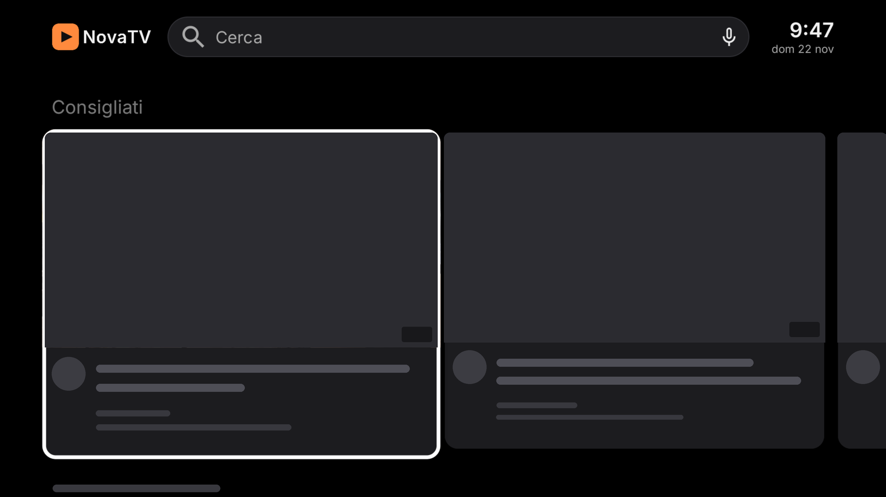
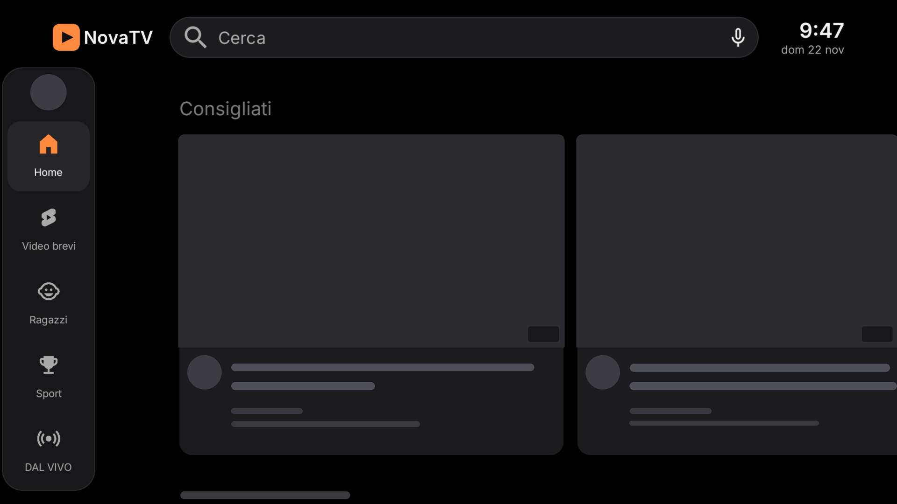
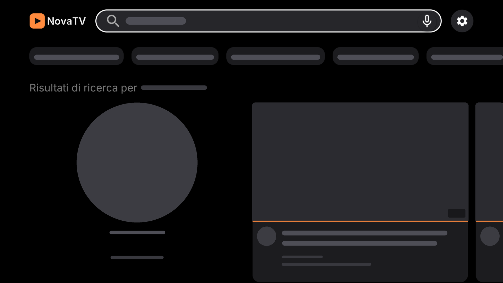
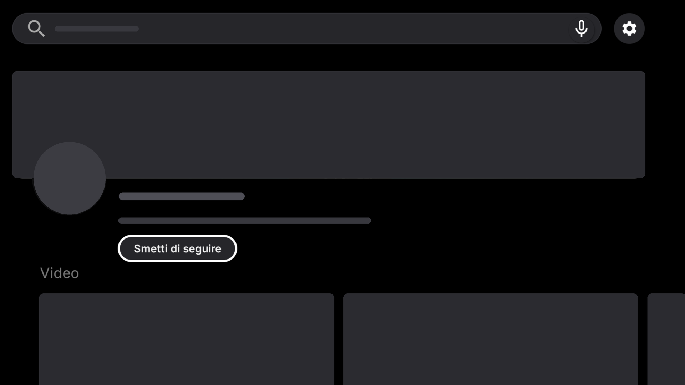
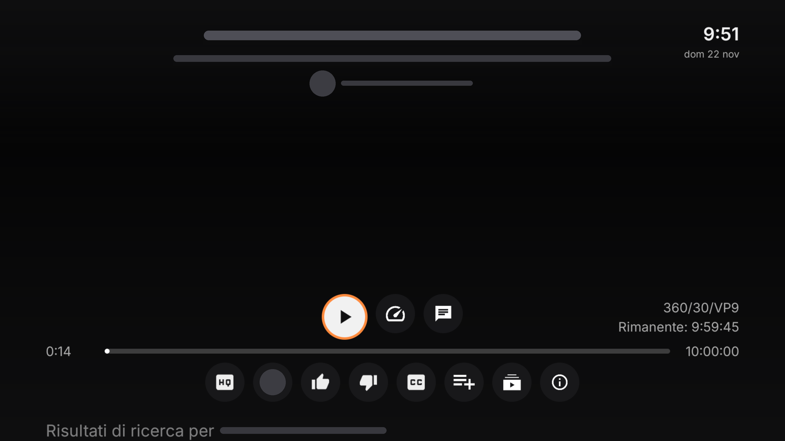
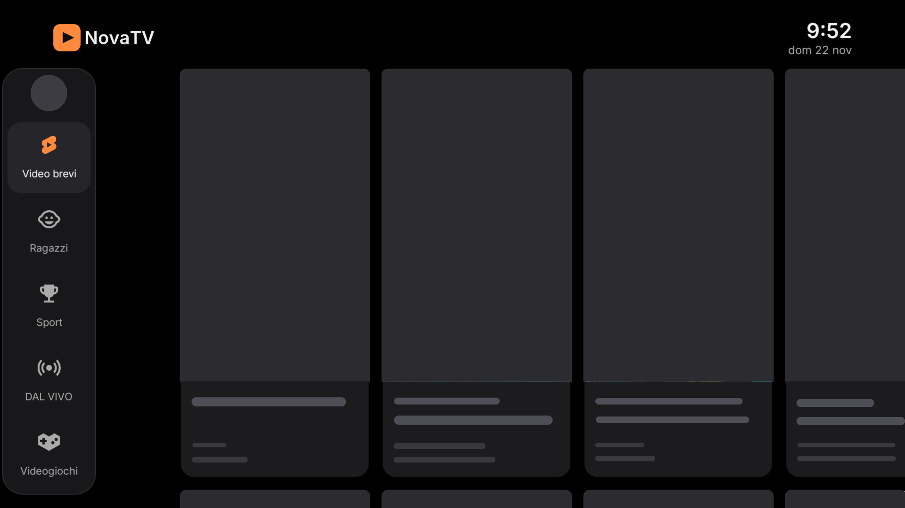
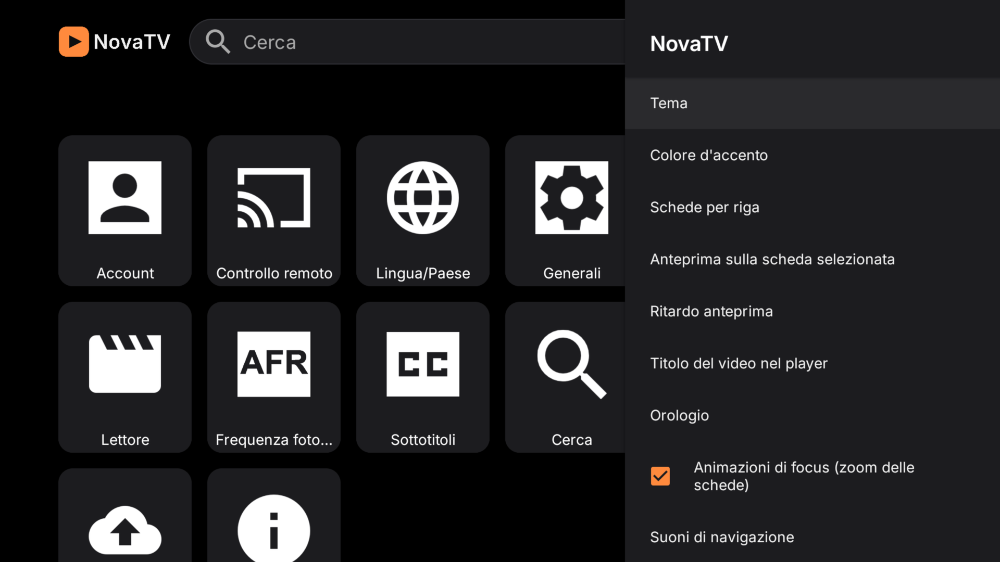

# NovaTV

[🇺🇸 English](README.md) | 🇮🇹 **Italiano**

Un'interfaccia moderna e scura per guardare video su Android TV, pensata per il telecomando.

- Design scuro e pulito (Scuro o nero puro OLED), quattro colori d'accento, schede arrotondate con l'avatar del canale
- Barra di ricerca a tutta larghezza, menu laterale flottante con la tua immagine del profilo in alto, player centrato con pulsanti rotondi
- Blocco della pubblicità e SponsorBlock integrati
- Tutte le impostazioni in un unico posto, compresa una schermata **NovaTV** dedicata (tema, accento, schede per riga,
  anteprima delle schede, orologio, animazioni, posizione del titolo nel player, suoni di navigazione)
- Disponibile in 47 lingue, segue la lingua del dispositivo
- Pacchetto `app.novatv` (beta `app.novatv.beta`, fdroid `app.novatv.fdroid`)

Non viene usato nessun logo, nome, icona o font di YouTube/Google: il font è Inter (SIL OFL, `assets/fonts/INTER_LICENSE.txt`).

---

## Screenshot

Screenshot reali da una Android TV. Copertine dei video, titoli, nomi dei canali, immagini e termini di ricerca
sono sostituiti da segnaposto grigi: si vede solo l'interfaccia di NovaTV. Tutto quello che vedi qui (intestazione,
menu laterale, schede, pagina del canale, player, schermata delle impostazioni) è ciò che NovaTV cambia rispetto
all'app originale (vedi [Crediti](#6-crediti)).

<table>
<tr>
<td width="50%"><br><b>Home</b>: logo, barra di ricerca a tutta larghezza con microfono, orologio e data; schede arrotondate con l'avatar del canale, "canale" e "visualizzazioni · data" su righe separate, contorno bianco sulla selezione.</td>
<td width="50%"><br><b>Menu laterale</b>: un pannello flottante, leggermente in rilievo, con la tua immagine del profilo in alto (OK = cambia account, pressione lunga = impostazioni account) e sezioni con icona + etichetta.</td>
</tr>
<tr>
<td><br><b>Ricerca</b>: la stessa barra della Home, suggerimenti come chip, canali come schede rotonde con nome e iscritti sotto, avanzamento della visione nel colore d'accento.</td>
<td><br><b>Pagina del canale</b> come sul web: barra di ricerca in alto, banner, immagine del profilo sul suo bordo, nome, @handle · iscritti · video e un pulsante Iscriviti / Annulla iscrizione che mostra lo stato del tuo account.</td>
</tr>
<tr>
<td><br><b>Player</b>: titolo, riga di informazioni (visualizzazioni · data · mi piace) e canale in alto, orologio a destra, pulsanti rotondi, Play/Pausa bianco, barra più spessa con i tempi ai due lati.</td>
<td><br><b>Video brevi</b>: schede alte che partono sotto l'orologio e la data.</td>
</tr>
<tr>
<td><br><b>Impostazioni</b>: la schermata NovaTV dedicata (tema, accento, schede per riga, anteprima, titolo nel player, orologio, animazioni, suoni di navigazione).</td>
<td></td>
</tr>
</table>

---

## Indice

- [Screenshot](#screenshot)

1. [Compilare e installare](#1-compilare-e-installare)
2. [Cosa è cambiato, fase per fase](#2-cosa-è-cambiato-fase-per-fase)
3. [File per file](#3-file-per-file)
4. [Traduzioni](#4-traduzioni)
5. [Prendere gli aggiornamenti dal progetto originale](#5-prendere-gli-aggiornamenti-dal-progetto-originale)
6. [Crediti](#6-crediti)

---

## 1. Compilare e installare

**JDK:** OpenJDK **11–14** (AGP 7.4.2 richiede almeno la 11; con JDK più recenti l'app può andare in crash).

```bash
git clone --recursive https://github.com/Dexmodzz/NovaTV.git && cd NovaTV
# se è stato clonato senza --recursive:
git submodule update --init --recursive

JAVA_HOME=/percorso/del/jdk-11 ./gradlew assembleStstableDebug     # build di controllo
JAVA_HOME=/percorso/del/jdk-11 ./gradlew assembleStstableRelease   # APK da installare
```

APK: `smarttubetv/build/outputs/apk/ststable/release/NovaTV_stable_<versione>_<abi>.apk`
(`arm64-v8a` per i dispositivi Android TV a 64 bit, altrimenti `armeabi-v7a` o `universal`).

```bash
adb connect <ip-della-tv>:5555
adb install -r smarttubetv/build/outputs/apk/ststable/release/NovaTV_stable_*_arm64-v8a.apk
```

> **Installa sempre la build release.** La build debug attiva il profiler di rete e il logger completo dei corpi HTTP
> in `SharedModules` (OkHttpCommons, `BuildConfig.DEBUG`): ogni pezzo di video passa dal log, l'avvio di un video
> richiede 6–11 s, la memoria si riempie e può comparire un "errore della sorgente". La release parte in circa 0,6 s.
>
> **Firma:** se esiste `keystore.properties`, la release usa quella chiave; altrimenti viene firmata con la chiave
> debug standard di Android. Così la release si compila sempre e si installa sopra una build debug senza perdere
> i dati dell'app. Per pubblicare l'app usa una chiave tua (`keystore.properties`); cambiare chiave in seguito
> obbliga a disinstallare l'app.

---

## 2. Cosa è cambiato, fase per fase

| Fase | Contenuto |
|---|---|
| **0 – Identità** | Pacchetto `app.novatv*`, nome "NovaTV", APK `NovaTV_*`, nuova icona e nuovo banner, authority della ricerca vocale aggiornate, aggiornamento interno disattivato (NovaTV non scarica mai l'APK del progetto originale), Firebase applicato solo quando `google-services.json` contiene il pacchetto NovaTV. |
| **1 – Design token** | Palette (sfondo `#0F0F10`, superfici `#1C1C1F`/`#26262A`, testo `#F1F1F1`/`#AAAAAA`, accenti arancio/blu/viola/verde), raggi, spaziature, scala tipografica; temi `App.Theme.Nova.Dark/Oled`; font Inter in tutte le schermate; gli 8 schemi di colore originali mantengono nome e posizione (l'indice salvato resta valido) ma corrispondono a Nova Scuro o Nova OLED. |
| **2 – Intestazione e menu laterale** | Intestazione: logo, barra di ricerca a tutta larghezza (con microfono), orologio + data, avatar. Menu laterale di 112dp con icona + etichetta. Schermata di ricerca con la stessa barra. I *chip* delle categorie sono stati poi rimossi su richiesta: tutte le sezioni sono tornate nel menu laterale. |
| **3 – Schede video e Home** | Schede arrotondate a 14dp su superficie scura, contorno bianco + zoom 1,05 sulla selezione, vero avatar del canale accanto al titolo, canali mostrati come immagine rotonda con nome e iscritti centrati sotto (contorno di selezione rotondo), "canale" e "visualizzazioni · data" su righe separate, barra di avanzamento nel colore d'accento. Navigazione interrompibile (destra e poi giù non si blocca più mentre una riga scorre). Riavvio automatico dopo un cambio di scala. |
| **4 – Player** | Pulsanti rotondi (etichetta solo sulla selezione), Play/Pausa bianco con anello d'accento, barra più spessa con i tempi ai due lati, layout centrato, sfumature; intestazione in alto con titolo, riga di informazioni (visualizzazioni · data · mi piace), avatar, canale · iscritti e orologio; chip "SponsorBlock: N segmenti"; i pulsanti si fermano ai bordi della riga invece di saltare alla barra. |
| **5 – Impostazioni** | Nuovo riquadro **NovaTV** nella griglia delle impostazioni: tema Scuro/OLED, colore d'accento, schede per riga (3–6), anteprima delle schede (disattivata/senza audio/con audio) e il suo ritardo, orologio e formato 24h, animazioni della selezione, posizione del titolo nel player (in alto / sopra le informazioni del video). I riquadri delle impostazioni hanno un contorno di selezione. |
| **Dopo** | Logo leggibile (Inter SemiBold), banner del launcher = logo dell'intestazione, barra di ricerca a tutta larghezza su qualsiasi dimensione dello schermo, risultati della ricerca subito sotto la barra (che si nasconde solo quando i risultati la coprono), tutti i testi NovaTV tradotti. Pagina del canale come la pagina del canale sul web: barra di ricerca in alto, poi banner, immagine del profilo sul bordo del banner, nome, @handle · iscritti · video e un pulsante Iscriviti / Annulla iscrizione che mostra lo stato del tuo account e prende la selezione quando il canale si apre. Indicatore di caricamento bianco più piccolo, avvio dei video e salti in avanti/indietro più rapidi, suoni di navigazione (15 a scelta), menu laterale flottante con l'immagine del profilo, video brevi sotto l'orologio. |

---

## 3. File per file

Regola generale: **il codice nuovo sta in file nuovi** (`novatv_*`, `Nova*`); i file originali ricevono solo piccoli
agganci, sempre segnati da un commento `NovaTV`. Per trovarli tutti:

```bash
git grep -n "NovaTV" -- ':!README*.md'
```

### 3.1 File nuovi

**Modulo `common`**

| File | Scopo |
|---|---|
| `common/.../prefs/NovaTVData.java` | Preferenze aggiunte da NovaTV, in un file a parte (`novatv_prefs`): accento, ritardo dell'anteprima, animazioni della selezione, posizione del titolo nel player, suoni. Applica l'overlay del colore d'accento. |
| `common/.../presenters/settings/NovaTVSettingsPresenter.java` | Schermata delle impostazioni "NovaTV". Dove esiste già un'impostazione originale (schema di colore, scala della griglia, anteprima, orologio, 12/24h) scrive quella stessa impostazione. |
| `common/.../misc/NovaFonts.java` | Applica Inter ai `TextView` creati dai layout (factory di `LayoutInflater`), su tutte le versioni di Android. |
| `common/src/main/res/values*/novatv_strings.xml` | Testi della schermata NovaTV, un file per lingua (generati, vedi [Traduzioni](#4-traduzioni)). |
| `common/.../misc/NovaDefaults.java`, `common/src/main/assets/novatv_defaults/app_prefs/*` | Configurazione predefinita di NovaTV (layout, schede, sezioni, player, schermata NovaTV). Scritta una sola volta, solo su una nuova installazione, prima che venga letta qualsiasi impostazione; un aggiornamento non tocca mai le impostazioni salvate. Non contiene account, cronologia o dati personali. |
| `common/src/main/res/drawable-nodpi/settings_novatv.png` | Icona (tavolozza) del riquadro NovaTV; generata da `tools/novatv/gen_settings_icon.py`. |
| `common/.../misc/NovaUiSounds.java`, `common/res/raw/novatv_sound_01..15.wav` | Suoni di navigazione leggeri (originali, generati da `tools/novatv/gen_sounds.py`): un breve suono quando la selezione si sposta, lo stesso un po' più basso su OK. Nelle impostazioni NovaTV: disattivati / bassi / normali e 15 suoni tra cui scegliere (ognuno si sente quando lo scegli; `NovaTVData.ui_sounds`, `ui_sound_type`). Il clic di sistema è silenziato nei temi dell'app (`android:soundEffectsEnabled`); nessun suono quando gli effetti sonori sono disattivati nelle impostazioni della TV. I suoni non si sovrappongono mai scorrendo veloce. |

**Modulo `smarttubetv` – Java**

| File | Scopo |
|---|---|
| `tv/ui/browse/NovaSections.java` | Divisione delle sezioni tra menu e chip. I chip sono disattivati (`CHIPS_ENABLED = false`): tutte le sezioni sono nel menu laterale. |
| `tv/ui/playback/other/NovaPlayerHeader.java` | Intestazione in alto nel player (titolo/canale e orologio), con una dissolvenza interrompibile insieme ai controlli. |
| `tv/ui/playback/other/NovaPlayerTitle.java` | Riempie titolo + avatar + "canale · iscritti" nell'intestazione in alto (insieme alla riga visualizzazioni · data · mi piace) o nel blocco sopra le informazioni del video, a seconda dell'impostazione. |
| `tv/util/NovaAvatars.java` | Veri avatar dei canali sulle schede e nel player. Fonti, dalla più veloce: la cache salvata sul dispositivo (`novatv_avatars_v3`), l'elenco delle iscrizioni, le schede dei canali sullo schermo (ad es. il canale nei risultati di ricerca, riusato per i suoi video e le sue playlist), poi i metadati del video (al massimo 4 richieste alla volta, solo per le schede visibili). In cache per id del canale e per nome del canale. |
| `tv/util/NovaInitialDrawable.java` | Cerchio colorato con l'iniziale del canale, mostrato finché l'avatar non è caricato. |
| `tv/util/NovaSpinnerDrawable.java` | Indicatore di caricamento: arco bianco sottile su un anello tenue, si allunga e si accorcia mentre gira (pagine, player, schede in caricamento). |
| `tv/ui/playback/other/NovaSeekDispatcher.java` | I salti fatti dall'utente (tasti avanti/indietro, barra) atterrano sul fotogramma chiave più vicino (al massimo a 4 s), così il video riparte subito invece di decodificare fino al fotogramma esatto. Gli altri salti (salto dei segmenti, posizione salvata, telecomando remoto) restano esatti. |
| `res/layout/lb_headers_fragment.xml`, `tv/ui/widgets/browse/NovaRailAccountView.java` | Menu laterale come pannello flottante leggermente in rilievo (`novatv_rail_panel_bg`) con l'avatar del profilo in alto (OK = account successivo / elenco, pressione lunga = impostazioni account, nascosto quando il pulsante degli account è disattivato). Id originali mantenuti. |

**Modulo `smarttubetv` – risorse**

| File | Scopo |
|---|---|
| `res/values/novatv_colors.xml` | Palette e sostituzioni dei colori Leanback `lb_*`. |
| `res/values/novatv_dimens.xml` | Raggi, spaziature, dimensioni del testo, misure di intestazione/menu/player/barra di ricerca; sostituzioni di alcune dimensioni Leanback (`lb_*`). |
| `res/values/novatv_themes.xml` | Temi `App.Theme.Nova.*`, attributi `novaAccent`/`novaChipBg`/`novaPlayBg`, overlay `NovaAccent.Orange/Blue/Violet/Green`. |
| `res/values*/novatv_strings.xml` | Testi dell'interfaccia (ad es. "SponsorBlock: %d segmenti"), un file per lingua (generati). |
| `res/drawable/novatv_*.xml` | Sfondi: scheda, contorno di selezione, pillola, barra di ricerca, pulsanti del player, chip, menu laterale, barre di avanzamento per ogni accento, banner del launcher (`novatv_banner.xml`). |
| `res/color/novatv_*.xml` | Colori del testo di pillole e chip per stato. |
| `res/layout/lb_control_button_secondary.xml` | Pulsante del player a pillola con etichetta (sostituisce quello Leanback). |
| `res/layout/novatv_player_title_block.xml` | Blocco titolo/canale sopra la riga di informazioni del video. |
| `common/.../utils/NovaChannelInfo.java` | Dati dell'intestazione del canale (banner, avatar, nome, @handle, iscritti, numero di video). La libreria principale non espone il banner, quindi legge i dati pubblici della pagina del canale (richiesta anonima, lingua del dispositivo), in cache per canale. |
| `tv/ui/channel/NovaChannelHero.java` | Riempie l'intestazione del canale e gestisce il pulsante Iscriviti / Annulla iscrizione: stesse chiamate di iscrizione del menu del video; lo stato viene dall'account collegato (metadati di un video del canale, come il pulsante di iscrizione del player); il pulsante prende la selezione quando il canale si apre. |
| `res/layout/novatv_channel_hero.xml`, `res/drawable/novatv_channel_banner_bg.xml`, `novatv_channel_avatar_ring.xml` | Layout dell'intestazione del canale: banner, avatar sul bordo inferiore, testi, pulsante. |
| `res/mipmap-nodpi/novatv_logo.png` | Logo dell'intestazione, usato anche come banner e come `android:logo`. |
| `assets/fonts/inter_*.ttf` + `INTER_LICENSE.txt` | Font Inter (OFL). |

**Strumenti** (`tools/novatv/`, servono solo per rigenerare immagini e testi)

| File | Scopo |
|---|---|
| `gen_icons.py` | Icona dell'app (quadrato arrotondato + triangolo play). |
| `gen_logo.py` | Logo dell'intestazione con la scritta in Inter SemiBold (richiede `pycairo`). |
| `gen_settings_icon.py` | Icona del riquadro delle impostazioni NovaTV. |
| `gen_strings.py` | Traduzioni di tutti i testi NovaTV; scrive ogni `novatv_strings.xml`. |
| `gen_sounds.py` | I 15 suoni di navigazione (sintetizzati, stesso volume percepito). |
| `mask_screenshots.py` | Copre i contenuti dei video negli screenshot del README con segnaposto grigi (`docs/screenshots/`: `*_en.png` per `README.md`, `*_it.png` per `README_IT.md`). |

### 3.2 File originali modificati

**Build e identità**

| File | Modifica |
|---|---|
| `smarttubetv/build.gradle` | `applicationId` → `app.novatv*`, nome dell'APK `NovaTV`, Firebase solo se configurato per NovaTV, release firmata con la chiave debug quando manca `keystore.properties`. |
| `smarttubetv/novatv.gradle` | Versione di NovaTV (`versionName`). |
| `smarttubetv/src/main/AndroidManifest.xml` | `android:banner` → `@drawable/novatv_banner`, `android:logo` → `@mipmap/novatv_logo`. |
| `smarttubetv/src/*/res/values/strings.xml` | Nome dell'app. |
| `leanbackassistant/src/*/res/values/strings.xml`, `.../xml/searchable.xml` | Authority della ricerca vocale con i nuovi pacchetti. |
| `smarttubetv/src/*/res/mipmap-*/app_icon*.png`, `app_banner.png` | Icona e banner di NovaTV. |
| `smarttubetv/.../ui/main/MainApplication.java` | Chiama `NovaDefaults.applyIfFreshInstall()` prima che venga letta qualsiasi impostazione. |
| `common/.../prefs/AppPrefs.java` | Un nuovo profilo senza una propria disposizione delle sezioni usa quella predefinita (`sidebar_data`). |
| `common/.../dialogs/AppUpdatePresenter.java` | L'aggiornamento interno non parte per i pacchetti NovaTV. |

**Temi e impostazioni**

| File | Modifica |
|---|---|
| `common/.../prefs/MainUIData.java` | Gli 8 schemi di colore corrispondono ai temi Nova (nomi e ordine invariati). |
| `common/.../misc/MotherActivity.java` | Applica l'overlay del colore d'accento dopo il tema; aggancia `NovaUiSounds` in `dispatchKeyEvent` e lo precarica in `onCreate`. |
| `common/.../misc/AppDataSourceManager.java` | Aggiunge il riquadro NovaTV alla griglia delle impostazioni. |
| `common/.../settings/MainUISettingsPresenter.java`, `UIScaleSettingsPresenter.java` | Riavvio automatico dopo aver cambiato la scala dell'interfaccia o della griglia (senza, l'interfaccia restava tagliata sopra 1,3x). |
| `smarttubetv/.../ui/common/LeanbackActivity.java` | Zoom della selezione da `NovaTVData` (animazioni attive/disattive). |
| `smarttubetv/.../util/ViewUtil.java` | `FOCUS_ZOOM_FACTOR` non più `final`, così si può configurare. |
| `smarttubetv/.../presenter/SettingsCardPresenter.java` | Riquadri delle impostazioni con contorno di selezione. |
| `smarttubetv/src/main/res/values/colors.xml`, `dimens.xml` | Alcuni valori allineati alla palette e al menu stretto (`lb_browse_rows_margin_start`). |
| `res/values/styles.xml` | Clic di sistema silenziato nei quattro temi di base. |
| `res/values/novatv_themes.xml` | `brandColor` trasparente: il pannello è lo sfondo del menu laterale. |

**Intestazione, menu, Home, ricerca**

| File | Modifica |
|---|---|
| `res/layout/lb_title_view.xml` | Intestazione riscritta: logo, barra di ricerca a tutta larghezza con microfono, orologio/data. **Tutti gli id originali sono mantenuti.** |
| `res/layout-ldrtl/lb_title_view.xml` | **Eliminato**: il nuovo layout si specchia da solo per le lingue da destra a sinistra. |
| `tv/ui/widgets/browse/NavigateTitleView.java` | Barra di ricerca, microfono, navigazione col telecomando nell'intestazione, pulsante "torna al video" che non occupa spazio quando non serve; l'avatar del profilo non è più nell'intestazione (spostato nel menu laterale). |
| `tv/ui/browse/BrowseFragment.java` | Selezione delle sezioni, intestazione nascosta quando il menu si apre sopra righe già scorse; selezione nel menu laterale: barra di ricerca → avatar → sezioni. |
| `tv/presenter/IconHeaderItemPresenter.java`, `res/layout/icon_header_item.xml` | Voci del menu laterale (icona sopra, etichetta sotto, selezione arrotondata). |
| `tv/presenter/VideoCardPresenter.java`, `ShortsCardPresenter.java` | Schede arrotondate, avatar del canale; gli elementi canale (`NovaAvatars.isRealChannel`: id "UC...", playlist escluse) hanno lo stile rotondo del canale. |
| `tv/ui/widgets/complexcardview/ComplexImageCardView.java` | Riga avatar + canale, sottotitolo su due righe; `setChannelStyle()`: immagine rotonda, testi centrati, nessuno sfondo della scheda, contorno di selezione rotondo. |
| `tv/ui/widgets/complexcardview/ComplexImageView.java` | Ritardo dell'anteprima da `NovaTVData`. |
| `tv/ui/mod/leanback/misc/ProgressBarManager.java`, `LoadingCardView.java`, `PreviewCardView.java`, `view_loading_card.xml`, `widget_preview_card.xml` | `NovaSpinnerDrawable` al posto del vecchio indicatore di caricamento. |
| `tv/ui/browse/video/ShortsGridFragment.java` | Le schede dei video brevi (più alte di metà schermo) partono subito sotto l'orologio e la data invece di essere centrate sopra di essi. |
| `res/layout/lb_search_bar.xml`, `res/drawable/rounded_search_bg.xml` | Barra della schermata di ricerca identica a quella della Home (id originali mantenuti). |
| `tv/ui/mod/leanback/search/SearchSupportFragment.java` | Risultati subito sotto la barra; la barra si nasconde solo quando i risultati la coprono. |
| `tv/presenter/ChannelHeaderPresenter.java` | Nessun logo dell'app nella barra di ricerca della pagina del canale. |

**Player**

| File | Modifica |
|---|---|
| `res/layout/lb_playback_fragment.xml` | Intestazione in alto (titolo, visualizzazioni · data · mi piace, avatar, canale · iscritti, orologio). |
| `res/layout/lb_playback_transport_controls_row.xml` | Layout centrato, tempi ai due lati della barra, tempo rimanente in alto a destra, chip SponsorBlock. |
| `res/drawable/player_background_controls.xml`, `player_background_suggestions.xml` | Sfumature. |
| `tv/ui/playback/PlaybackFragment.java` | Mostra/nasconde l'intestazione in alto insieme ai controlli; riga di informazioni più corta (canale e iscritti sono nel titolo); `NovaSeekDispatcher` sull'adapter del player. |
| `tv/ui/mod/leanback/playerglue/tweaks/MaxControlsVideoPlayerGlue.java` | Aggancio di `NovaPlayerTitle`, testi centrati. |
| `.../tweaks/PlaybackTransportRowPresenter.java` | Chip SponsorBlock (conta i segmenti, capitoli esclusi). |
| `.../tweaks/ControlBar.java` | Distanza minima tra i pulsanti, sinistra/destra si spostano di un pulsante alla volta e si fermano ai bordi, rimossa la `LayoutTransition` che faceva perdere la selezione ai pulsanti. |
| `.../tooltips/ControlButtonPresenterSelector.java` | Etichetta del pulsante visibile solo sulla selezione, Play/Pausa bianco più grande. |
| `tv/ui/mod/leanback/misc/SeekBar.java` | Colori della barra (traccia e buffer). |
| `common/.../exoplayer/other/ExoPlayerInitializer.java` | La riproduzione parte (e riprende dopo un salto) con 1 s nel buffer invece di 2,5 s, 3 s dopo un'interruzione invece di 5 s; il buffer "medio" tiene gli ultimi 15 s, così tornare un po' indietro non ricarica. Le dimensioni del buffer scelte nelle impostazioni non cambiano. |
| `exoplayer-amzn-2.10.6/.../chunk/ChunkSampleStream.java`, `.../sabr/SabrMediaPeriod.java` | `getBufferedSyncPositionUs()`: gli stream SABR non hanno un indice dei segmenti, quindi un salto non esatto si aggancia all'inizio di un pezzo già nel buffer (sempre un fotogramma chiave). |

**Pagina del canale**

| File | Modifica |
|---|---|
| `res/layout/channel_header.xml` | Barra di ricerca del canale in alto, `novatv_channel_hero` sotto. |
| `tv/presenter/ChannelHeaderPresenter.java` | Collega `NovaChannelHero`; quando l'impostazione della barra di ricerca del canale è disattivata si nasconde la barra (non l'intera riga). |
| `tv/ui/channel/ChannelFragment.java` | La riga di intestazione viene sempre aggiunta (contiene l'intestazione del canale); passa i primi video del canale a `NovaChannelHero` (stato dell'iscrizione, selezione). |

**Libreria Leanback inclusa nel repository**

| File | Modifica |
|---|---|
| `leanback-1.0.0/.../widget/GridLayoutManager.java` | Una modifica (due punti segnati `MOD: NovaTV`): in `onInterceptFocusSearch` i tasti che cambiano riga non vengono più scartati mentre la riga scorre (navigazione interrompibile). |

**Non toccati:** `MediaServiceCore/`, `SharedModules/` (sottomoduli: API, blocco della pubblicità, SponsorBlock).

---

## 4. Traduzioni

L'app usa la lingua del dispositivo, a meno che non se ne scelga un'altra in Impostazioni → Lingua/Paese.
I testi di base vengono dal progetto originale; i testi NovaTV (schermata delle impostazioni NovaTV, chip SponsorBlock,
etichetta della ricerca vocale, suoni) sono tradotti in tutte le lingue supportate
(47 locali, più gli alias `iw`/`mo` di ebraico e rumeno). L'inglese è la lingua di riserva.

I file `novatv_strings.xml` sono **generati**: modifica le tabelle in `tools/novatv/gen_strings.py` ed esegui

```bash
python3 tools/novatv/gen_strings.py
```

Per aggiungere un testo NovaTV: aggiungi la chiave a `COMMON_KEYS` (impostazioni, modulo `common`) o `APP_KEYS`
(interfaccia, modulo `smarttubetv`), aggiungi la sua traduzione per ogni lingua nella tabella, esegui lo script.
I formati dei numeri (ad es. "0.5 s" / "0,5 s") vengono dalla lingua del dispositivo.

---

## 5. Prendere gli aggiornamenti dal progetto originale

NovaTV è costruito sopra un progetto open source (vedi [Crediti](#6-crediti)); i suoi miglioramenti e le sue
correzioni si possono unire. Il modello: un ramo locale `master` = copia esatta del progetto originale (solo sul tuo
computer, mai pubblicato), `novatv` = master + le modifiche NovaTV (il ramo pubblicato qui). Aggiorna sempre prima
`master`, poi unisci `master` in `novatv`, poi pubblica `novatv`.

### 5.1 Una sola volta

```bash
git clone --recursive https://github.com/Dexmodzz/NovaTV.git && cd NovaTV
# il progetto originale, usato solo per prendere gli aggiornamenti
git remote add upstream https://github.com/yuliskov/SmartTube.git
git fetch upstream
git branch master upstream/master   # copia locale del progetto originale

# Git ricorda come hai risolto un conflitto e la volta dopo lo risolve da solo
git config rerere.enabled true

# Non toccare i fine riga: molti file Java originali sono CRLF
git config core.autocrlf false
```

### 5.2 A ogni aggiornamento

```bash
git fetch upstream

# 1) master = upstream (solo fast-forward: master non contiene nessuna nostra modifica)
git checkout master
git merge --ff-only upstream/master

# 2) porta le novità in novatv
git checkout novatv
git merge master

# 3) sottomoduli alla versione indicata da upstream (non modificarli mai)
git submodule update --init --recursive

# 4) controllo
JAVA_HOME=/percorso/del/jdk-11 ./gradlew assembleStstableDebug assembleStstableRelease

# 5) pubblica
git push origin novatv
```

### 5.3 Perché i conflitti sono rari e dove possono capitare

- La maggior parte del lavoro è in **file nuovi** (`novatv_*`, `Nova*`): upstream non li conosce, quindi non possono andare in conflitto.
- I file originali modificati hanno quasi sempre **poche righe**, segnate `NovaTV`. Un conflitto lì si risolve tenendo il nuovo codice di upstream e rimettendo il blocco `NovaTV`.
- Le risorse Leanback sostituite (`lb_*.xml`) sono file dell'app con lo stesso nome di quelli della libreria: un aggiornamento della libreria non le tocca.

File in cui un conflitto è possibile e come risolverlo:

| File | Cosa fare |
|---|---|
| `res/layout/lb_title_view.xml`, `lb_search_bar.xml`, `lb_playback_fragment.xml`, `lb_playback_transport_controls_row.xml`, `lb_headers_fragment.xml` | Sono riscritti. Tieni la versione NovaTV (`git checkout --ours <file>`) e aggiungi a mano gli eventuali **nuovi id** introdotti da upstream (il codice Java li cerca per id). |
| `res/layout-ldrtl/lb_title_view.xml` | Se upstream lo modifica ottieni un conflitto "modificato/eliminato": lascialo eliminato (`git rm <file>`). |
| `NavigateTitleView.java`, `BrowseFragment.java`, `PlaybackFragment.java`, `ControlBar.java`, `SearchSupportFragment.java`, `ChannelHeaderPresenter.java`, `ChannelFragment.java` | Tieni le modifiche di upstream e rimetti i blocchi `NovaTV`. |
| `MainUIData.java` (schemi di colore) | Se upstream aggiunge uno schema, aggiungilo in fondo puntando a `App.Theme.Nova.Dark` o `.Oled`, senza cambiare l'ordine degli altri (l'indice salvato deve restare valido). |
| `build.gradle` | Tieni le novità di upstream (versione, dipendenze) e le modifiche NovaTV: applicationId `app.novatv*`, nome dell'APK `NovaTV`, condizione di Firebase, firma di riserva (`signingConfigs.debug`). |
| `README.md`, `README_IT.md`, `PRIVACY.md`, `LICENSE` | Tieni la versione NovaTV: `git checkout --ours <file>` (la LICENSE mantiene già l'avviso di copyright originale). |
| Icone/banner `.png`, `strings.xml` (`app_name`) | Tieni la versione NovaTV: `git checkout --ours <file>`. |
| `ExoPlayerInitializer.java`, `exoplayer-amzn-2.10.6/.../ChunkSampleStream.java`, `SabrMediaPeriod.java` | Tieni le modifiche di upstream e rimetti le righe `NovaTV` (soglie del buffer, `getBufferedSyncPositionUs`). |
| `leanback-1.0.0/.../GridLayoutManager.java` | Cerca `MOD: NovaTV` (due punti in `onInterceptFocusSearch`) e riapplica la modifica. |
| Nuova lingua di upstream (`values-xx`) | Aggiungi la lingua a `tools/novatv/gen_strings.py` ed eseguilo, altrimenti lì i testi NovaTV compaiono in inglese. |

Durante un merge:

```bash
git status                          # file in conflitto
git checkout --ours  <file>         # tieni NovaTV
git checkout --theirs <file>        # tieni upstream
git add <file> && git commit        # completa il merge
git merge --abort                   # oppure annulla tutto e torna a prima del merge
```

> **File CRLF:** molti file Java (ad es. `MotherActivity.java`, `AppDataSourceManager.java`, `ViewUtil.java`,
> `NavigateTitleView.java`, `MaxControlsVideoPlayerGlue.java`) usano i fine riga di Windows. Modificali con un
> editor che mantiene i fine riga, altrimenti il diff diventa l'intero file e ogni merge successivo va in conflitto.
> Per controllare: `file <percorso>` deve dire "with CRLF line terminators".

### 5.4 Dopo l'aggiornamento

1. Compila debug e release (vedi sopra).
2. Installa la release sulla TV e controlla velocemente:
   - Home: intestazione, menu laterale, schede, avatar;
   - ricerca: barra e risultati;
   - player: intestazione in alto, pulsanti, SponsorBlock;
   - Impostazioni → NovaTV.
3. Se upstream aggiunge una nuova sezione al menu, controlla che abbia la sua icona nel menu laterale (`IconHeaderItemPresenter`).

---

## 6. Crediti

NovaTV è basato su **[SmartTube](https://github.com/yuliskov/SmartTube)** di **Yuriy Liskov (yuliskov)**,
rilasciato con licenza MIT. Tutto il cuore dell'app (API video, riproduzione, blocco della pubblicità, SponsorBlock,
impostazioni) è opera sua; NovaTV aggiunge la nuova interfaccia sopra di esso. Grazie!

L'avviso di copyright originale è mantenuto in [`LICENSE`](LICENSE), come richiede la licenza MIT.

Il font Inter è di Rasmus Andersson, rilasciato con licenza SIL Open Font License.
